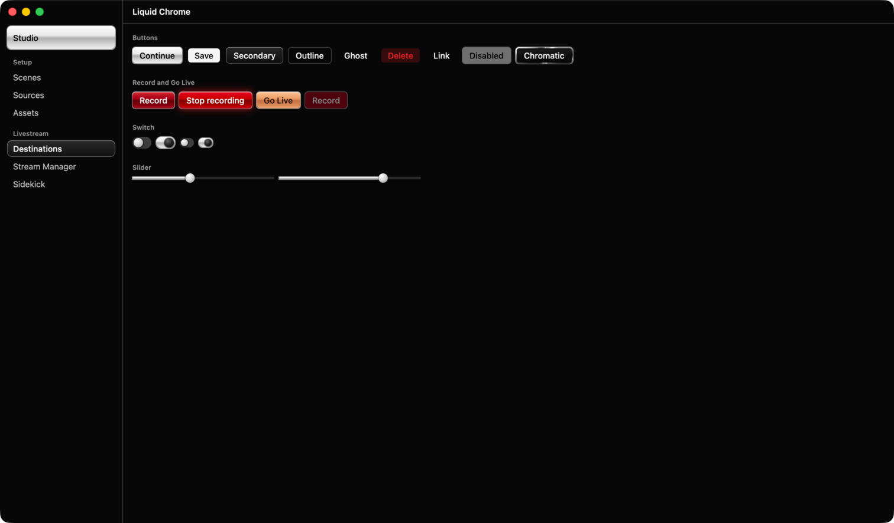
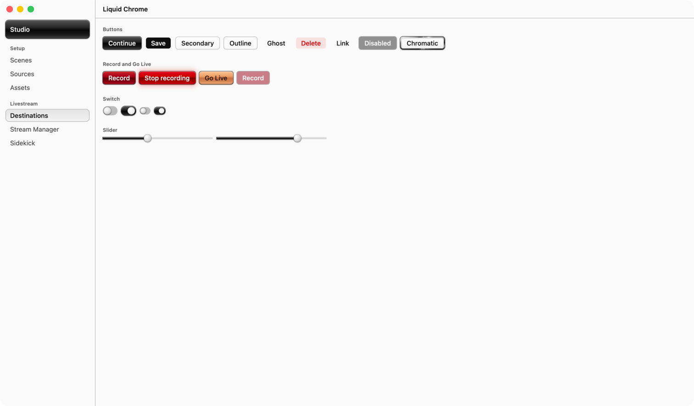

# spike-chrome: Liquid Chrome in GPUI (plan 260 S0.4, WC-0.6)

Videorc's Liquid Chrome controls drawn by GPUI: a sidebar with the Studio
slab and a plated row, the 40 px toolbar, every Button variant, Record
(idle, lit and disabled), Go Live, Switch and Slider. On macOS the owner
judged this look equal to Electron's on 2026-11-24 (plan 260, "S0.4 results
on macOS"). WC-0.6 takes the same shots on Windows, so the owner can judge
the look there too.

It is a look spike: the shots are its result, so it writes no
`summary.json`. It reads its settings from environment variables, not from
the system: it ignores Windows' dark or light mode and its contrast themes.

## Run it on Windows

The one-time setup is the [Windows testing plan's](../../../plans/260-gpui-rewrite-windows-testing.md#one-time-setup).
In PowerShell, from a clone of `TheOrcDev/videorc`:

```powershell
git fetch origin
git switch spikes/gpui
git pull
cd spikes\gpui
cargo build --release -p spike-chrome
```

Then one run per appearance. Each run stays open for `LC_SECS` seconds and
quits by itself:

```powershell
$env:LC_ROUTE = "raster"; $env:LC_FREEZE = "0"; $env:LC_SECS = "60"

$env:LC_THEME = "dark";  $env:LC_CONTRAST = "0"; cargo run --release -p spike-chrome
$env:LC_THEME = "light"; $env:LC_CONTRAST = "0"; cargo run --release -p spike-chrome
$env:LC_THEME = "dark";  $env:LC_CONTRAST = "1"; cargo run --release -p spike-chrome
$env:LC_THEME = "light"; $env:LC_CONTRAST = "1"; cargo run --release -p spike-chrome
```

- `LC_ROUTE=raster` is the route the kit takes: each metal fill is
  rasterised once per size and scale. Always set it for the shots.
  (`bands` is the other route S0.4 compared; the default is `bands`.)
- `LC_FREEZE=0` holds the Chromatic button's turning ring in one pose, so
  every shot shows the same frame.
- `LC_CONTRAST=1` is Increase Contrast: the theme's stronger edges, as
  Videorc draws them when macOS's Increase Contrast is on.
- The window hides the title bar, as every Videorc window does, so it may
  have no close button on Windows. It quits after `LC_SECS`; Alt+F4 closes
  it sooner. `LC_TITLEBAR=system` shows a standard title bar if you need to
  move it.

## The shots

Take each with Alt+Print Screen (the active window) or Win+Shift+S in
window mode, at **100 %** scale and again at **your highest scale**
(Settings > System > Display > Scale). If the window is larger than the
screen at a high scale, press Win+Up to maximise it: the page is laid out
from the top left, so every control stays in view.

| Shot | Run |
| --- | --- |
| `windows-dark-100.png`, `windows-dark-<scale>.png` | `LC_THEME=dark`, `LC_CONTRAST=0` |
| `windows-light-100.png`, `windows-light-<scale>.png` | `LC_THEME=light`, `LC_CONTRAST=0` |
| `windows-dark-contrast-100.png`, `windows-dark-contrast-<scale>.png` | `LC_THEME=dark`, `LC_CONTRAST=1` |
| `windows-light-contrast-100.png`, `windows-light-contrast-<scale>.png` | `LC_THEME=light`, `LC_CONTRAST=1` |

Each shot shows the whole window. Check these against the macOS shots
below:

- **Buttons:** Continue, Save, Secondary, Outline, Ghost, Delete, Link,
  Disabled and Chromatic. The metal fills, their top and bottom lines, the
  corners and the drop under each.
- **Record and Go Live:** Record, lit Record (Stop recording, with its red
  glow), Go Live and disabled Record.
- **Switch:** off, on, and the small pair.
- **Slider:** both sliders, the track, the filled part and the thumb.
- **The pane:** the sidebar's Studio slab, the plated Destinations row, the
  section labels, the hairlines and the 40 px toolbar with its title.

**Expected:** the same colours and corners as macOS, no jagged or blurry
edges, and text sharp at both scales. The text is Segoe UI, not SF, so its
shapes differ; its weights should still read as on macOS (Medium on the
buttons and the plated row, Semibold on the labels and the title).

**Send:** the eight shots, and a note on anything that differs from macOS
beyond the font.

## The macOS shots

Window shots from S0.4's second round on an M4 at 2x, halved here, after
the `gpui-pre-apple` patch that draws weight 500 as SF Medium (this
workspace does not carry that patch; it changes nothing on Windows).

| Dark | Light |
| --- | --- |
|  |  |
|  |  |

## On macOS

```sh
cd spikes/gpui
LC_ROUTE=raster LC_FREEZE=0 LC_THEME=dark cargo run --release -p spike-chrome
```

It prints `[lc] window-number <n>`, for `screencapture -o -x -l<n> out.png`.
Without the patch, weight 500 draws SF Regular here.

## Other settings

| Variable | Effect |
| --- | --- |
| `LC_CHROMATIC=0` | Leaves out the Chromatic button |
| `LC_MOTION=redraw` | Turns the ring by redrawing the page every frame (S0.4's cost comparison), in place of GPUI's animation clock |
| `LC_MAX_FPS=<n>` | Caps the ring's animation (the kit caps it at 60) |
| `LC_FRAMES=1` | Counts the frames drawn, printed at the end |
| `LC_MINIMIZE_AFTER=<s>` | Minimises the window after that many seconds (the ring must then cost nothing) |
| `LC_PROBE=1` | Adds a row of buttons at each weight from 400 to 700 |
